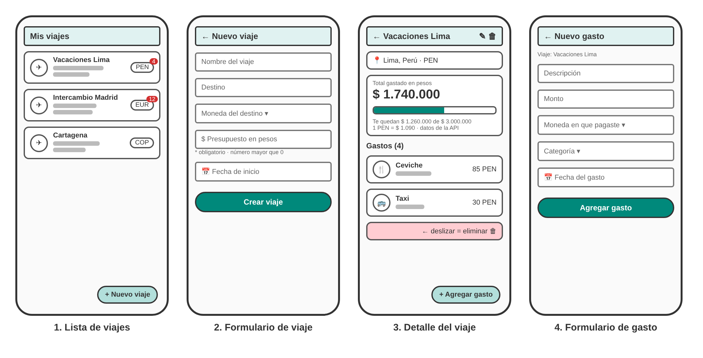
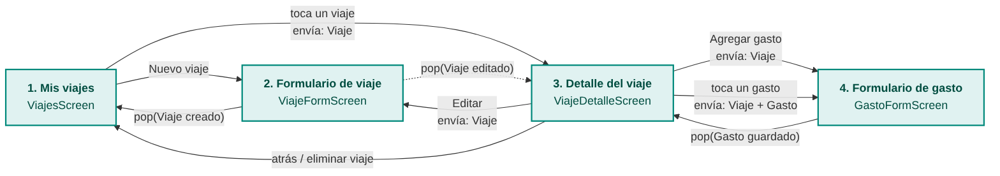
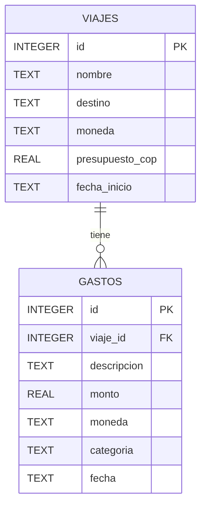

# Gastos de Viaje

Aplicación móvil en Flutter para registrar los gastos de un viaje en cualquier moneda y ver, en pesos colombianos, cuánto se ha gastado y cuánto queda del presupuesto.

> Trabajo final · Lenguajes de Computación para Móviles

---

## 1. El problema

Cuando una persona de Colombia viaja al exterior, paga en la moneda del destino: soles, euros, dólares. Pero su presupuesto lo pensó en **pesos**. Cada compra la obliga a hacer cuentas mentales con una tasa de cambio que cambia todos los días, y al final del día no sabe cuánto lleva gastado ni cuánto le queda.

Las notas del celular o una hoja de cálculo no resuelven esto: guardan el monto, pero no lo convierten, y llenarlas en la calle es incómodo.

**Por qué una app móvil:** el gasto ocurre en la calle, con el celular en la mano. La app permite registrar el gasto en el momento, guarda los datos en el teléfono aunque no haya internet, y cuando hay conexión los convierte a pesos con la tasa del día.

## 2. Usuarios y alcance

**Usuarios:** personas en Colombia que viajan al exterior con un presupuesto limitado en pesos, por ejemplo estudiantes de intercambio, mochileros y familias de vacaciones. La usan durante el viaje, justo después de pagar algo.

**Qué hace:**

- Crear, editar y eliminar viajes, cada uno con su destino, la moneda del destino, un presupuesto en pesos y la fecha de inicio.
- Registrar, editar y eliminar gastos de cada viaje, con descripción, monto, moneda, categoría y fecha.
- Guardar todo en el dispositivo (SQLite): los datos siguen ahí después de cerrar la app.
- Consultar la tasa de cambio del día en una API y mostrar el total gastado en pesos, lo que falta del presupuesto y una barra de avance que se pone roja si se pasa.
- Sin internet, seguir mostrando los gastos y sus totales en la moneda original, con un botón para reintentar la conversión.

**Qué no hace (fuera del alcance):**

- No sincroniza entre dispositivos ni tiene cuentas de usuario.
- No lee recibos con la cámara ni se conecta a bancos.
- No guarda tasas de cambio históricas: convierte todos los gastos con la tasa del día de la consulta, no con la del día en que se pagó.
- No divide gastos entre varias personas.

## 3. Diseño

Bocetos de las cuatro pantallas, hechos antes de programar:



Decisiones de diseño:

- **La lista de viajes es la pantalla inicial**, porque un usuario puede tener varios viajes (el actual y los anteriores).
- **El total en pesos va arriba del detalle**, porque es la pregunta que el usuario se hace más seguido: "¿cuánto llevo?".
- **Un gasto nuevo usa por defecto la moneda del destino**, para que registrar un gasto tome pocos toques.
- **Para borrar un gasto se desliza** (`Dismissible`), y siempre pide confirmación para evitar borrados por accidente.

## 4. La aplicación funcionando

> **Pendiente:** tomar las capturas en el emulador y guardarlas en `docs/capturas/` con estos nombres.

| Lista de viajes | Formulario de viaje | Detalle del viaje | Formulario de gasto |
|---|---|---|---|
|  |  |  |  |

| Validación del formulario | Sin conexión (error de la API) | Borrar deslizando |
|---|---|---|
|  |  |  |

## 5. Flujo entre pantallas



| Desde | Hacia | Cómo | Dato que viaja |
|---|---|---|---|
| Mis viajes | Formulario de viaje | `Navigator.push` | — (viaje nuevo) |
| Formulario de viaje | Mis viajes | `Navigator.pop` | El `Viaje` creado |
| Mis viajes | Detalle del viaje | `Navigator.push` | El `Viaje` tocado |
| Detalle del viaje | Formulario de viaje | `Navigator.push` | El `Viaje` a editar, y vuelve editado con `pop` |
| Detalle del viaje | Formulario de gasto | `Navigator.push` | El `Viaje` (y el `Gasto`, si se edita uno) |
| Formulario de gasto | Detalle del viaje | `Navigator.pop` | El `Gasto` guardado |

Todas las rutas usan `MaterialPageRoute`. Los datos de ida viajan por el constructor de la pantalla, y los de vuelta como resultado de `Navigator.pop(context, valor)`.

## 6. Cómo funciona

> **Pendiente:** grabar un GIF corto del flujo completo y guardarlo como `docs/capturas/demo.gif`.


1. **Abrir la app.** `ViajesScreen` lee los viajes de SQLite y cuántos gastos tiene cada uno. Si no hay viajes, muestra un mensaje que invita a crear el primero.
2. **Crear un viaje.** El formulario valida que nombre y destino no estén vacíos y que el presupuesto sea un número mayor que cero. Al guardar, el viaje se inserta en la tabla `viajes` y la lista se recarga.
3. **Abrir un viaje.** `ViajeDetalleScreen` hace dos cosas al mismo tiempo: lee los gastos de SQLite y consulta las tasas de cambio a la API. Mientras la API responde, muestra "Consultando tasas de cambio...".
4. **Ver el resumen.** Con las tasas, convierte cada gasto a pesos, los suma y compara el total con el presupuesto.
5. **Agregar un gasto.** El formulario de gasto valida los campos y lo guarda en la tabla `gastos`. Al volver, el detalle recarga los gastos y el total se actualiza.
6. **Borrar.** Un gasto se borra deslizándolo a la izquierda, previa confirmación. Al borrar un viaje, SQLite borra también sus gastos (`ON DELETE CASCADE`).
7. **Sin internet.** El resumen muestra el error, los totales en la moneda original (que sí están en el teléfono) y un botón **Reintentar**. También se puede deslizar la pantalla hacia abajo para recargar todo.

## 7. Modelo de datos y persistencia

**Mecanismo elegido: SQLite con `sqflite`.**



- **Tabla `viajes`:** un registro por viaje.
- **Tabla `gastos`:** un registro por gasto, con `viaje_id` como llave foránea hacia `viajes`. Un viaje tiene muchos gastos.
- Las fechas se guardan como texto ISO 8601 (`2026-12-20T00:00:00.000`), porque SQLite no tiene tipo fecha y así se pueden ordenar como texto.
- La categoría se guarda como texto (`'comida'`, `'transporte'`...) y en Dart se convierte al `enum Categoria`.

Los modelos de Dart (`lib/models/`) tienen `toMap()` para convertir el objeto en una fila y `fromMap()` para hacer lo contrario.

**Por qué SQLite y no un archivo JSON:**

| Criterio | SQLite (elegido) | Archivo JSON |
|---|---|---|
| Visto en clase | Sí | No, habría que investigarlo |
| Relación viaje → gastos | Llave foránea y borrado en cascada | Hay que manejarla a mano |
| Consultas | Filtrar, ordenar y contar con SQL | Leer todo el archivo y filtrar en Dart |
| Modificar un gasto | Se actualiza una fila | Se reescribe el archivo completo |
| Plataforma | Android/iOS (no funciona en web) | Android/iOS/escritorio |

La limitación de SQLite es que no funciona en el navegador. Por eso la app se prueba y se presenta en el emulador de Android.

## 8. La API usada

**ExchangeRate-API, endpoint abierto** (gratuito, no necesita clave): https://www.exchangerate-api.com/docs/free

- **Endpoint:** `GET https://open.er-api.com/v6/latest/COP`
- **Qué se usa:** las tasas con base en pesos colombianos. Cada tasa dice cuántas unidades de una moneda equivalen a 1 peso, así que para convertir un gasto a pesos se divide el monto por la tasa: `10 USD / 0.00025 = 40.000 COP`.
- **Por qué base COP:** con una sola consulta se pueden convertir a pesos gastos en cualquier moneda.
- **Actualización:** la API actualiza las tasas una vez al día.
- **Atribución:** sus condiciones piden citarla, por eso la app muestra "Tasas por ExchangeRate-API" debajo del resumen.

Ejemplo de respuesta (resumida, con valores ilustrativos):

```json
{
  "result": "success",
  "base_code": "COP",
  "time_last_update_unix": 1767225601,
  "time_last_update_utc": "Thu, 01 Jan 2026 00:00:01 +0000",
  "rates": {
    "COP": 1,
    "USD": 0.000245,
    "EUR": 0.000219,
    "PEN": 0.000917
  }
}
```

**Manejo de estados y errores** (`lib/services/tasas_api_service.dart`):

| Situación | Qué hace la app |
|---|---|
| Esperando respuesta | Muestra un indicador de carga |
| Respuesta correcta | Convierte el JSON en el modelo `TasasCambio` y muestra el resumen |
| Más de 10 segundos sin respuesta | Cancela la espera (`timeout`) y muestra "El servidor tardó demasiado" |
| Sin internet | Muestra "Sin conexión a internet" |
| Código 429 | Muestra "Demasiadas consultas, espera unos minutos" |
| Otro código de error o JSON inválido | Muestra un mensaje de error |
| En todos los errores | Botón **Reintentar** y los totales en moneda original |

## 9. Dependencias

| Paquete | Para qué se usa |
|---|---|
| `sqflite` | Base de datos SQLite en el dispositivo |
| `path` | Armar la ruta del archivo de la base de datos (`join`) |
| `http` | Hacer la petición GET a la API de tasas de cambio |
| `flutter_localizations` (SDK) | Mostrar en español el calendario y los textos propios de Flutter |
| `flutter_lints` (desarrollo) | Reglas de estilo que revisa `flutter analyze` |
| `flutter_test` (desarrollo) | Pruebas automáticas |

No se usa ningún paquete de manejo de estado: todo se resuelve con `StatefulWidget` y `setState`, como se vio en clase.

## 10. Cómo ejecutar la aplicación

**Requisitos:** Flutter 3.35 o superior y un emulador o celular **Android**. SQLite no funciona en el navegador.

```bash
git clone https://github.com/USUARIO/gastos_viaje.git
cd gastos_viaje
flutter pub get
flutter run
```

Para revisar la calidad del código y correr las pruebas:

```bash
flutter analyze
flutter test
```

La app necesita internet para la conversión a pesos. El permiso `INTERNET` está declarado en `android/app/src/main/AndroidManifest.xml`.

## 11. Integrantes

| Integrante | Aporte |
|---|---|
| Steban Rivera | _Completar_ |
| _Nombre del compañero_ | _Completar_ |

## 12. Fuentes y ayudas utilizadas

- **Documentación oficial de Flutter:** [docs.flutter.dev](https://docs.flutter.dev) y [api.flutter.dev](https://api.flutter.dev) (Navigator, Form, Dismissible, DropdownButtonFormField).
- **Paquete sqflite:** [pub.dev/packages/sqflite](https://pub.dev/packages/sqflite), para abrir la base, crear tablas y hacer el CRUD.
- **Paquete http:** [pub.dev/packages/http](https://pub.dev/packages/http), incluido `MockClient` para las pruebas.
- **ExchangeRate-API:** [documentación del endpoint abierto](https://www.exchangerate-api.com/docs/free).
- **Asistente de IA:** usamos **Claude (Anthropic)** para proponer la idea del proyecto, generar la estructura y el código base de la aplicación, las pruebas, los diagramas y los bocetos, y redactar el borrador de este README. El código lo revisamos, lo ejecutamos y lo probamos nosotros en el emulador. _(Agregar aquí qué partes modificaron o escribieron ustedes.)_

## 13. Limitaciones y posibles mejoras

**Limitaciones:**

- Todos los gastos se convierten con la tasa del día de la consulta, no con la del día en que se pagaron.
- Sin internet no hay conversión a pesos; solo se ven los totales en la moneda original.
- Los montos se escriben sin puntos de miles (`3000000`), porque el punto se interpreta como decimal.
- SQLite no funciona en la versión web de la app.
- Los datos viven solo en un teléfono: si se desinstala la app, se pierden.

**Mejoras posibles:**

- Guardar en SQLite la última tasa consultada, para convertir aunque no haya internet.
- Guardar la tasa con cada gasto, para respetar el valor del día en que se pagó.
- Una pantalla de estadísticas con gastos por categoría.
- Exportar los gastos de un viaje a CSV.
- Gastos compartidos entre varios viajeros.
